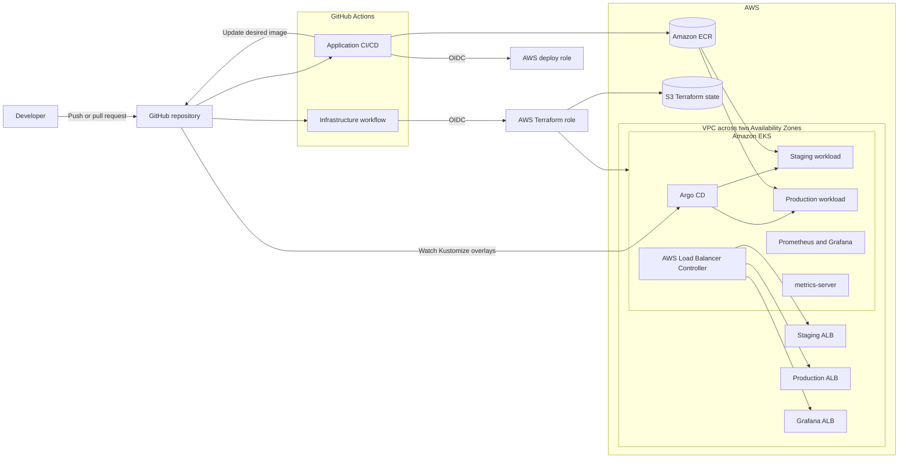

# Task API: End-to-End DevOps on AWS EKS

A production-style Node.js REST API deployed to Amazon EKS through Terraform, GitHub Actions, Kustomize, and Argo CD.

The project implements a complete delivery platform:

- AWS infrastructure provisioned with Terraform
- Temporary AWS credentials through GitHub Actions OIDC
- Immutable container images stored in Amazon ECR
- Automated testing, linting, vulnerability scanning, and image signing
- Staging and production Kubernetes environments
- GitOps reconciliation and self-healing through Argo CD
- Public ingress through the AWS Load Balancer Controller
- Horizontal Pod Autoscaling using metrics-server
- Prometheus monitoring and Grafana dashboards
- Automated workload, load balancer, and infrastructure teardown

## Architecture



Terraform creates the AWS infrastructure and installs the cluster services. The application pipeline builds and signs an immutable image, updates the desired state in Git, and waits for Argo CD to reconcile each environment.

## Technology stack

| Area | Implementation |
|---|---|
| Application | Node.js 24, Express, `node:test`, Supertest |
| Container | Multi-stage Docker image based on Node.js Alpine |
| Infrastructure | Terraform 1.10+ with S3 remote state |
| AWS | VPC, EKS, ECR, IAM, S3, NAT Gateway, ALB |
| Kubernetes | Kustomize base with staging and production overlays |
| GitOps | Argo CD `v3.6.3`, Helm chart `10.19.1` |
| Ingress | AWS Load Balancer Controller using EKS Pod Identity |
| Autoscaling | HPA backed by the EKS metrics-server add-on |
| Monitoring | kube-prometheus-stack `70.4.2` and Grafana |
| CI/CD | GitHub Actions with AWS OIDC and environment approvals |
| Supply chain | Hadolint, Trivy, Cosign, ECR scanning, Dependabot |

## Repository structure

```text
.
├── .github/
│   ├── dependabot.yml
│   └── workflows/
│       ├── app-cicd.yml
│       └── terraform.yml
├── app/
│   ├── src/
│   │   ├── app.js
│   │   └── server.js
│   ├── test/
│   │   └── app.test.js
│   ├── .dockerignore
│   ├── Dockerfile
│   └── package.json
├── k8s/
│   ├── argocd/
│   │   ├── production-application.yaml
│   │   └── staging-application.yaml
│   ├── base/
│   ├── overlays/
│   │   ├── production/
│   │   └── staging/
│   ├── 05-servicemonitor.yaml
│   └── 06-grafana-ingress.yaml
├── terraform/
│   ├── bootstrap/
│   ├── infra/
│   └── helm-values-monitoring.yaml
└── README.md
```

- `app/` contains the API, tests, and container definition.
- `terraform/bootstrap/` contains the example variables file and creates the remote-state bucket, GitHub OIDC provider, and pipeline IAM roles.
- `terraform/infra/` creates the VPC, ECR repository, EKS cluster, add-ons, and AWS Load Balancer Controller identity.
- `k8s/base/` contains resources shared by both environments.
- `k8s/overlays/` defines the staging and production differences.
- `k8s/argocd/` defines the Argo CD Applications.
- `.github/workflows/` contains the infrastructure and application pipelines.

## Application and local development

The API listens on port `3000` by default.

| Method and path | Purpose |
|---|---|
| `GET /` | Service version, environment, hostname, and deployment information |
| `GET /healthz` | Liveness endpoint |
| `GET /readyz` | Readiness endpoint |
| `GET /metrics` | Prometheus metrics |
| `GET /api/tasks` | List tasks |
| `POST /api/tasks` | Create a task |
| `GET /api/tasks/:id` | Retrieve a task |
| `PATCH /api/tasks/:id` | Update a task |
| `DELETE /api/tasks/:id` | Delete a task |

Tasks are stored in memory and are lost when the process or Pod restarts.

### Run locally

```bash
cd app
npm ci
npm test
npm start
```

Verify the API:

```bash
curl http://localhost:3000/healthz

curl -X POST http://localhost:3000/api/tasks \
  -H "Content-Type: application/json" \
  -d '{"title":"Test the deployment"}'

curl http://localhost:3000/api/tasks
```

### Run with Docker

```bash
docker build -t task-api:local app
docker run --rm -p 3000:3000 --read-only task-api:local
curl http://localhost:3000/healthz
```

The image uses a multi-stage build, installs production dependencies only, and runs as an unprivileged user. The Kubernetes deployment also enforces a non-root security context and a read-only root filesystem.

## Infrastructure and initial setup

### Prerequisites

Install:

- AWS CLI v2
- Terraform 1.10 or newer
- Docker
- Node.js 22 or newer; Node.js 24 is used by CI and the container image
- `kubectl`
- Helm
- Git

Configure a local AWS principal with enough permissions to create the bootstrap IAM, S3, and OIDC resources:

```bash
aws configure
aws sts get-caller-identity
```

### Infrastructure defaults

| Setting | Default |
|---|---|
| Project | `capstone` |
| Environment | `dev` |
| AWS region | `us-east-1` |
| VPC CIDR | `10.0.0.0/16` |
| Kubernetes version | `1.37` |
| Worker instance type | `t3.small` |
| Desired worker count | `3` |
| Minimum worker count | `1` |
| Maximum worker count | `3` |
| Capacity type | On-Demand |
| EKS API endpoint | Public |

Confirm that the configured Kubernetes version is supported by Amazon EKS before provisioning.

### Bootstrap AWS

Copy the provided example variables file:

```powershell
Copy-Item terraform\bootstrap\terraform.tfvars.example terraform\bootstrap\terraform.tfvars
```

Update `terraform/bootstrap/terraform.tfvars` with values for your AWS region, project, GitHub owner, and repository:

```hcl
aws_region     = "us-east-1"
project        = "capstone"
github_owner   = "your-github-username"
github_owner_id = "your-github-owner-numeric-id"
github_repo    = "task-api"
github_repo_id = "your-repository-numeric-id"
```

The numeric owner and repository IDs are used in the GitHub OIDC trust policy so repository or organization renames do not weaken the identity check.

Run the bootstrap stack:

```bash
cd terraform/bootstrap
terraform init
terraform fmt -check
terraform validate
terraform plan
terraform apply
terraform output
```

The bootstrap creates:

- The S3 bucket used for Terraform remote state
- Native S3 state locking
- The GitHub Actions OIDC provider
- A read-only Terraform planning role
- A Terraform apply role
- An application deployment role

The bootstrap state is stored locally. Keep it available until the AWS infrastructure and bootstrap resources have both been destroyed.

### Configure GitHub

Add these repository variables under **Settings → Secrets and variables → Actions → Variables**:

| Variable | Value |
|---|---|
| `AWS_REGION` | Region used by the bootstrap stack |
| `TF_STATE_BUCKET` | Bootstrap output |
| `AWS_PLAN_ROLE_ARN` | Bootstrap output |
| `AWS_TERRAFORM_ROLE_ARN` | Bootstrap output |
| `AWS_DEPLOY_ROLE_ARN` | Bootstrap output |
| `EKS_CLUSTER_NAME` | Normally `capstone-dev` |
| `ECR_REPOSITORY` | Normally `capstone-dev-task-api` |

Create these GitHub environments:

| Environment | Purpose |
|---|---|
| `infrastructure` | Approval boundary for infrastructure apply and destroy |
| `staging` | Automatic staging deployment |
| `production` | Production deployment approval boundary |

No long-lived AWS access keys are stored in GitHub. The workflows exchange GitHub OIDC tokens for temporary AWS credentials.

## CI/CD and GitOps

### Infrastructure workflow

The `Terraform (Infrastructure)` workflow runs when infrastructure files change and can also be started manually.

On pull requests, it:

1. Checks Terraform formatting.
2. Initializes the S3 backend with native state locking.
3. Validates the configuration.
4. Creates a Terraform plan using the read-only planning role.
5. uploads the plan as a short-lived workflow artifact.

On a push to `main`, or a manual `apply`, the workflow waits for approval through the `infrastructure` environment and applies the saved plan using the Terraform role.

After provisioning, it installs:

- AWS Load Balancer Controller
- kube-prometheus-stack chart `70.4.2`
- The production `ServiceMonitor`
- The Grafana Ingress
- Argo CD chart `10.19.1`
- The staging and production Argo CD Applications

The workflow waits for the Argo CD Application CRD and application controller before applying the Applications.

### Application workflow

Pull requests that change the application, Kubernetes resources, or application workflow run the unit tests and Dockerfile linting.

For deployable runs, the workflow:

1. Runs the tests with Node.js 24.
2. Checks the Dockerfile with Hadolint.
3. Builds the container image.
4. Smoke-tests `/healthz` locally.
5. Confirms the image does not run as root.
6. Scans for unfixed critical vulnerabilities with Trivy.
7. Pushes an immutable Git-SHA tag to Amazon ECR.
8. Signs the image using keyless Cosign signing.
9. Updates and commits the staging Kustomize overlay.
10. Waits for Argo CD to reconcile staging.
11. Verifies the staging rollout and tests `/healthz` through its ALB.
12. Waits for approval through the `production` environment.
13. Verifies the image signature.
14. Updates and commits the production overlay.
15. Verifies the production rollout and ALB health.

A fixed `app-deploy` concurrency group serializes deployment runs so staging and production desired-state updates cannot race.

### Argo CD

Argo CD watches these paths on the `main` branch:

- `k8s/overlays/staging`
- `k8s/overlays/production`

The Applications deploy to `task-api-staging` and `task-api` respectively. Automated synchronization, pruning, and self-healing are enabled.

The pipeline does not directly apply application Deployments. It commits the desired image and application version to Git, then waits for Argo CD to reconcile the cluster.

## Kubernetes platform

The application uses a shared Kustomize base containing:

- ConfigMap
- Deployment
- ClusterIP Service
- Horizontal Pod Autoscaler
- ALB Ingress

The overlays set the namespace, image, application version, and environment-specific configuration.

| Environment | Namespace | Deployment |
|---|---|---|
| Staging | `task-api-staging` | Automatic after a successful image build |
| Production | `task-api` | Requires approval through the GitHub `production` environment |

### Ingress

The AWS Load Balancer Controller creates separate internet-facing Application Load Balancers for staging, production, and Grafana.

Retrieve their hostnames with:

```bash
kubectl get ingress -A
```

The current configuration exposes HTTP endpoints without TLS and is intended for a temporary demonstration environment.

### Autoscaling

The EKS metrics-server add-on supplies CPU and memory resource metrics to the Horizontal Pod Autoscaler.

```bash
kubectl get hpa -A
kubectl top pods -n task-api
kubectl top pods -n task-api-staging
```

metrics-server supports Kubernetes autoscaling. It is separate from Prometheus, which stores application and platform metrics for monitoring.

### Monitoring

The infrastructure workflow installs kube-prometheus-stack in the `monitoring` namespace.

The API exposes Prometheus metrics on `/metrics`, including request counts, response status labels, request-duration histograms, and Node.js process metrics.

A `ServiceMonitor` scrapes the production service. Staging is intentionally validated through Kubernetes health, rollout checks, and pipeline smoke tests instead of a separate Prometheus target.

The Grafana dashboard displays:

- Request rate
- p95 request latency
- HTTP 5xx error percentage

Check the monitoring resources:

```bash
kubectl get pods -n monitoring
kubectl get servicemonitor -A
kubectl get ingress grafana -n monitoring
```

## Security and known limitations

Implemented controls include:

- GitHub Actions OIDC instead of stored AWS access keys
- Separate Terraform plan, Terraform apply, and application deployment roles
- Repository identity checks using immutable GitHub owner and repository IDs
- Namespace-scoped EKS access for application deployment
- Immutable ECR image tags
- ECR scan-on-push
- Trivy image scanning
- Keyless Cosign signing and production verification
- GitHub Actions pinned to commit SHAs
- Dependabot updates
- Non-root container execution
- Read-only container root filesystem
- Kubernetes resource requests and limits
- Production approval through GitHub Environments

Known limitations:

- The EKS API endpoint is public so GitHub-hosted runners can connect.
- Application and Grafana ALBs are public and use HTTP without TLS.
- The Grafana administrator password is currently stored in `terraform/helm-values-monitoring.yaml`.
- The VPC uses one NAT Gateway to reduce cost, which is not highly available across Availability Zones.
- Tasks are stored in memory and disappear when a process or Pod restarts.
- Bootstrap Terraform state is stored locally.
- Cluster services are installed by the infrastructure workflow after Terraform completes.

For a production deployment, restrict network access, enable TLS through AWS Certificate Manager, move the Grafana credential to a secret manager, use private runners or restricted EKS endpoint CIDRs, and use persistent application storage.

## Validation and operations

Run the application tests:

```bash
cd app
npm ci
npm test
```

Validate Terraform:

```bash
terraform -chdir=terraform/bootstrap fmt -check
terraform -chdir=terraform/bootstrap validate

terraform -chdir=terraform/infra fmt -check
terraform -chdir=terraform/infra validate
```

Render both Kustomize overlays:

```bash
kubectl kustomize k8s/overlays/staging
kubectl kustomize k8s/overlays/production
```

Inspect a live deployment:

```bash
kubectl get applications -n argocd
kubectl get all -n task-api
kubectl get all -n task-api-staging
kubectl get ingress -A
kubectl get hpa -A
```

## Teardown

Run the `Terraform (Infrastructure)` workflow manually with `action` set to `destroy`.

Before applying the Terraform destroy plan, the workflow:

1. Checks whether the EKS cluster still exists.
2. Deletes the Argo CD Applications.
3. Deletes both Kustomize overlays.
4. Deletes the `argocd` and `monitoring` namespaces.
5. Waits for load balancers in the VPC to disappear.
6. Force-deletes remaining load balancers if normal cleanup does not complete.
7. Waits for load balancer network interfaces to release.
8. Applies the Terraform destroy plan.

This ordering prevents Kubernetes-managed ALBs from blocking subnet and VPC deletion.

After the infrastructure has been destroyed, remove the bootstrap resources locally:

```bash
cd terraform/bootstrap
terraform destroy
```

Do not destroy the bootstrap stack first because the infrastructure workflow still depends on its state bucket and IAM roles.

## Cost considerations

The worker nodes use `t3.small` instances, which may be covered by eligible AWS Free Tier or promotional credits. However, the complete platform is not free because it also provisions:

- An Amazon EKS control plane
- Three `t3.small` worker nodes by default, which may exceed the available free compute allowance
- One NAT Gateway
- Application Load Balancers
- EBS storage, data transfer, and CloudWatch usage

Actual charges depend on the AWS account, region, usage, and current Free Tier eligibility. Configure an AWS Budget and destroy the environment when it is not being demonstrated.
